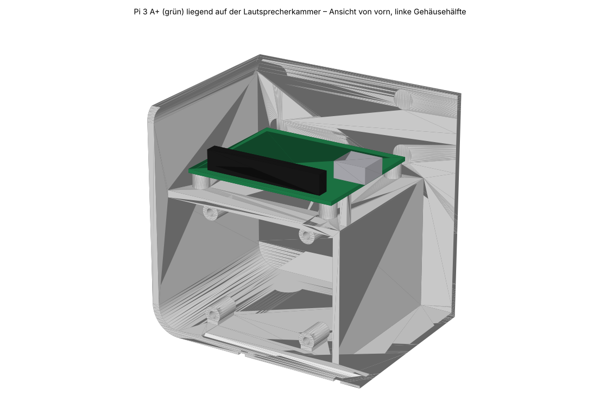
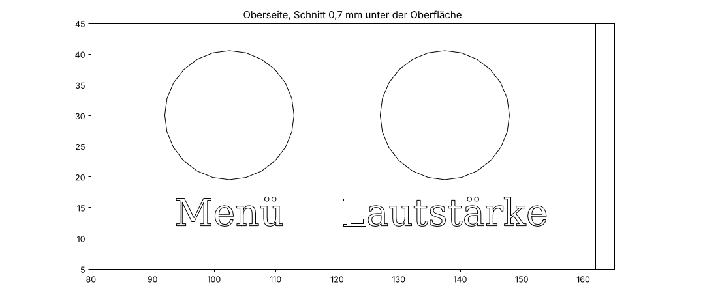

# Rückteil für den Raspberry Pi 3 Model A+

`../stl/chapter-case-back-v5-pi3a.stl` ersetzt das Rückteil `chapter-case-back-v5.stl`.
Frontdeckel und Knöpfe bleiben unverändert.

Änderungen gegenüber v5:

- Die vier Pi-Zero-Halter an der Rückwand (oben links) sind entfernt.
- Auf dem Deckel der Lautsprecherkammer stehen vier neue Halter für den Pi 3 A+:
  Lochbild 58 × 49 mm, 6 mm hoch, Ø 7 mm, Bohrung Ø 3,1 mm für dieselben
  M2,5-Gewindeeinsätze wie im restlichen Gehäuse.
- Die Gravur oben lautet "Menü" und "Lautstärke" statt "SELECT" und "VOLUME"
  (DejaVu Serif, 1,5 mm tief, Höhe der Großbuchstaben 4,5 mm).
- Der Pi liegt waagerecht, Platinenunterseite 6 mm über dem Kammerdeckel,
  rund 32 mm Luft bis zur Gehäusedecke. Lautsprecherkammer bleibt dicht
  (die Bohrungen enden 1 mm über dem Deckel).

`../stl/chapter-case-back-v5-zero-de.stl` ist das Original-Rückteil für den Pi Zero, nur mit deutscher Gravur.

Erzeugt mit `make_case.py` aus dem Original-STL (benötigt `trimesh` und `manifold3d`):

```bash
python3 make_case.py ../stl/chapter-case-back-v5.stl ../stl/chapter-case-back-v5-pi3a.stl
python3 make_case.py ../stl/chapter-case-back-v5.stl ../stl/chapter-case-back-v5-zero-de.stl --zero
```




