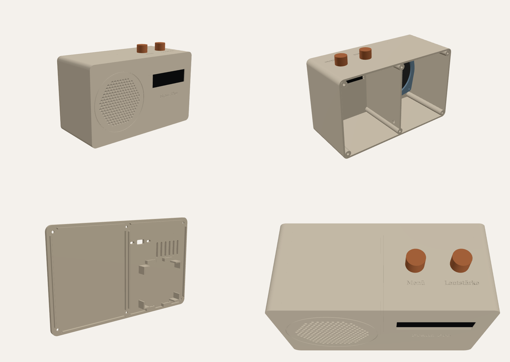

# Chapter Pro – Gehäuse Variante A „Radio“

224 × 135 × 105 mm (B × H × T). Passt auf das Druckbett des AnkerMake M5 (235 × 235 mm).



## Hardware

- Raspberry Pi 3 A+ auf PiSugar 3 Plus (5000 mAh), beide 65 × 56 mm
- 3,12″-OLED SSD1322 UN312-5664-7: Platine 100,5 × 33,5 mm, Löcher 95 × 28,5 mm, Pins rechts
- Dayton Audio ND90-4 hinter einem Lochgitter, in einer eigenen, geschlossenen Kammer (≈ 1,3 l Luftvolumen)
  - rechnerisch Qtc ≈ 0,86 und fc ≈ 125 Hz
  - mit etwas Dämmwolle etwas tiefer
- MAX98357A
- 2 × KY-040 oben, beschriftet mit „Menü“ und „Lautstärke“

## Teile

| Datei | Anzahl | Druck |
|---|---|---|
| `stl/chapter-pro-gehaeuse.stl` | 1 | Front nach unten, **ohne Stützen** |
| `stl/chapter-pro-rueckwand.stl` | 1 | Außenseite nach unten |
| `stl/chapter-pro-lautsprecherring.stl` | 1 | flache Seite nach unten |
| `../stl/chapter-case-knob-v5.stl` | 2 | wie beim Original |

**Empfohlene Einstellungen:**
- PLA oder PETG, 0,2 mm Schichthöhe
- 4 Wände, 20 % Gyroid-Füllung
- Skirt oder Brim höchstens 3 mm: das Gehäuse belegt 224 mm der 235 mm Bettbreite.

## Kleinteile

- **Gewindeeinsätze M3** (Ø 4,0 mm Bohrung, ca. 5,7 mm lang): 10 Stück
  - 6 in die Säulen für die Rückwand
  - 4 in die Lautsprecher-Dome
- **Schrauben:**
  - 6 × M3×10 (Zylinderkopf) für die Rückwand
  - 4 × M3×12 für den Lautsprecherring
  - 4 × Blechschraube 2,5 × 6 mm für das Display (in die vorgebohrten Dome)
- **2 Klett-Kabelbinder**, bis 12 mm breit, für den Pi/PiSugar-Stapel
- **USB-C-Einbaubuchse mit kurzem, gewinkeltem Kabel** (Panel-Mount, 20–30 cm): Öffnung 12,5 × 6,5 mm, Langlöcher für 25–32 mm Schraubabstand
- **Moosgummi-Dichtband** (ca. 3 × 2 mm) auf die hintere Kante der Lautsprecherkammer
- etwas **Dämmwolle** oder Polyesterwatte für die Kammer
- **4 Gummifüße** Ø 10 mm, für die Mulden im Boden

## Montage

1. **Gewindeeinsätze einschmelzen.**
2. **Lautsprecher:** Den ND90-4 von innen in den Zentrierring über dem Gitter legen. Den Lautsprecherring mit dem Rand zum Lautsprecher aufsetzen und mit 4 × M3×12 festziehen. So spielt der Lochkreis des Lautsprecherkorbs keine Rolle.
3. **Kabel:** Das Lautsprecherkabel durch das Loch in der Trennwand führen und das Loch mit Heißkleber abdichten. Die Kammer locker mit Dämmwolle füllen.
4. **Display:** Das Modul mit den Pins nach rechts (von vorn gesehen) auf die 4 Dome legen und mit 4 Blechschrauben festschrauben. Das Fenster sitzt genau über der Leuchtfläche laut Datenblatt.
5. **Drehgeber:**
   - Die KY-040 von innen durch die Löcher oben stecken und mit Unterlegscheibe und Mutter festziehen.
   - Die Wand dort ist auf 2 mm verdünnt.
6. **Rückwand bestücken:**
   - Den Pi/PiSugar-Stapel mit dem Akku nach unten zwischen die 4 Eckführungen legen.
   - Mit 2 Klett-Kabelbindern durch die Ösen festzurren. Alle Kanten bleiben frei.
   - Die USB-C-Einbaubuchse in die Rückwand schrauben und das Kabel in den USB-C-Anschluss des PiSugar stecken.
7. **Gehäuse schließen:**
   - Dichtband auf die Kammerkante kleben.
   - Rückwand aufsetzen und mit 6 × M3×10 verschrauben.

## Verbindung durch die Trennwand

Nur der Lautsprecher sitzt in der linken Kammer, alles andere rechts. Durch die Trennwand geht nur das zweiadrige Lautsprecherkabel: ein Ø-6-mm-Loch unten, nah an der Rückseite. Danach das Loch mit Heißkleber dicht machen.

## Noch offen

- **Glasdicke des Displays:** Die Dome sind 2,6 mm hoch. Liegt das Glas zu fest an, die Dome etwas abschleifen. Bleibt ein Spalt, ist das unkritisch.
- **Einschalten:** Wo der Taster am PiSugar sitzt, ist nicht dokumentiert. Der PiSugar 3 kann sich laut Hersteller automatisch einschalten, sobald wieder Strom anliegt.

## Anpassen

Alle Maße stehen oben in `make_chapter_pro.py`.

```bash
python3 make_chapter_pro.py stl
```
